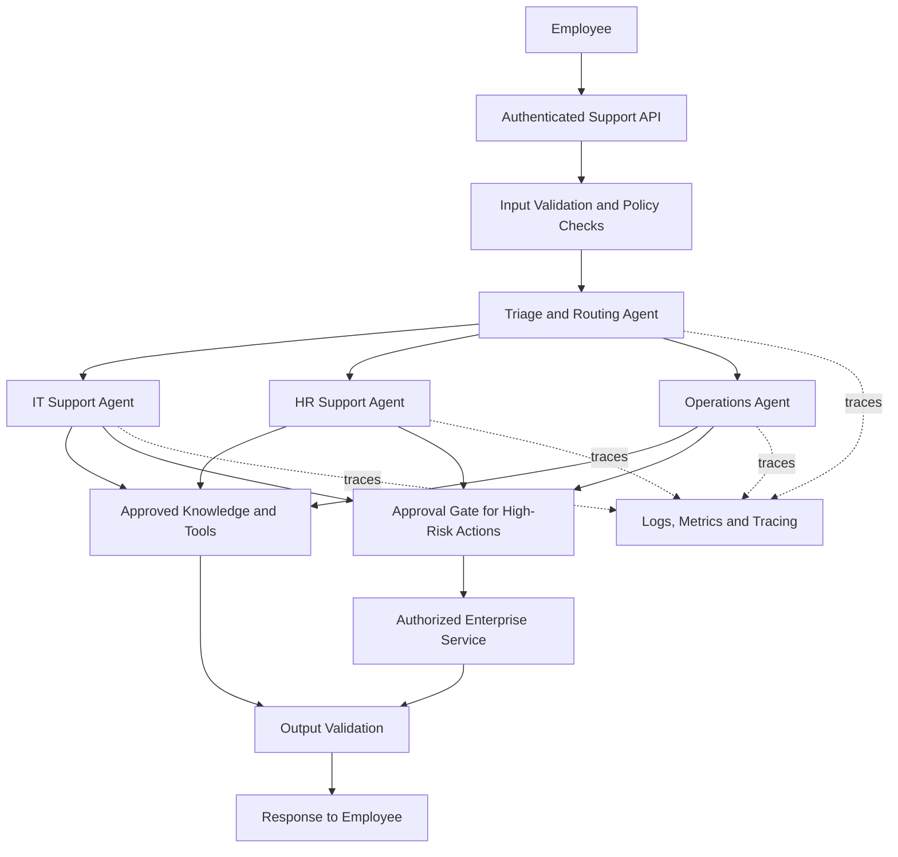

# OpenAI Agent Architecture Review
## Enterprise Internal Support Platform

### 1. Objective and architecture

The proposed platform helps employees resolve IT, HR, and internal operations questions using specialized AI agents. It uses the OpenAI Agents SDK for agent orchestration and the Responses API for model interactions. Access to enterprise knowledge and business tools is controlled by authenticated services.

### 2. Agent roles and handoffs

- **Triage agent:** Identifies intent, urgency, and required specialist; routes only to approved agents.
- **IT support agent:** Answers technical questions and uses permitted diagnostic tools.
- **HR support agent:** Retrieves approved HR policy information and avoids exposing confidential employee records.
- **Operations agent:** Helps with internal procedures and approved workflow requests.

The triage agent uses explicit routing rules and structured outputs. A handoff passes the relevant conversation context to the selected specialist. If intent is unclear, the system asks a clarifying question. If no specialist is appropriate, it escalates to a human support team. Agents cannot select arbitrary tools or bypass authorization checks.

### 3. Guardrails and stateful workflows

**Input guardrails:** Authenticate employees, validate request size and format, enforce access controls, and detect attempts to override system instructions. Treat retrieved documents and user-provided text as untrusted input.

**Tool guardrails:** Give each agent only the tools it needs. Validate tool arguments against schemas, enforce permissions in backend services, apply timeouts and rate limits, and record consequential actions. Never rely on the model alone to authorize a tool call.

**Output guardrails:** Check responses for sensitive information, unsupported claims, and policy violations. Ground knowledge answers in authorized internal sources and provide an escalation path when confidence or evidence is insufficient.

**Stateful workflow:** Maintain a conversation or workflow identifier and store only necessary state in an access-controlled persistence layer. Use Responses API conversation capabilities or Agents SDK sessions where appropriate. Keep authorization decisions and approval records in trusted backend storage. Apply retention and deletion policies to conversation data.

### 4. Human approvals

Require explicit human approval before high-impact actions such as changing employee permissions, issuing refunds, modifying sensitive HR records, or executing irreversible administrative operations. Show the reviewer the requested action, target, justification, and relevant evidence. Execute only after an authenticated approver approves the exact action. Reject expired or modified approvals and log the final result.

### 5. Tracing and observability

Use Agents SDK tracing to inspect agent runs, handoffs, tool calls, and failures. Collect operational metrics including request volume, latency, error rate, handoff frequency, escalation rate, tool failures, approval outcomes, and estimated model usage. Correlate events with a request ID. Redact secrets and sensitive personal information from logs, restrict trace access, and define retention limits. Alert on abnormal failures, latency, or unusual tool activity.

### 6. Risk analysis and mitigation

| Risk | Mitigation |
|---|---|
| Prompt injection | Treat external content as untrusted; enforce server-side policies |
| Unauthorized tool execution | Least privilege, backend authorization, schema validation |
| Sensitive data disclosure | Access controls, output filtering, redaction |
| Incorrect or fabricated answers | Retrieval grounding, evidence checks, human escalation |
| Harmful irreversible action | Human approval and idempotent execution |
| Agent loop or excessive cost | Step limits, timeouts, budgets, rate limits |
| Loss or misuse of conversation state | Access-controlled storage, retention rules, audit trail |
| Monitoring data exposure | Redacted logs, restricted access, retention limits |

### 7. Conclusion

The design separates language-model reasoning from trusted authorization and execution. Specialized agents improve task separation, while constrained handoffs, backend-enforced permissions, human approval, state controls, and tracing make the platform more manageable. Before production, validate the design with adversarial tests, access-control tests, failure simulations, and measured latency and cost targets.

**Implementation note:** This is an architecture proposal, not a deployed or production-validated system. Specific enterprise integrations, service-level objectives, and compliance requirements must be confirmed with the organization.
